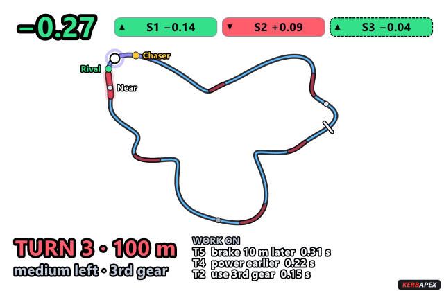
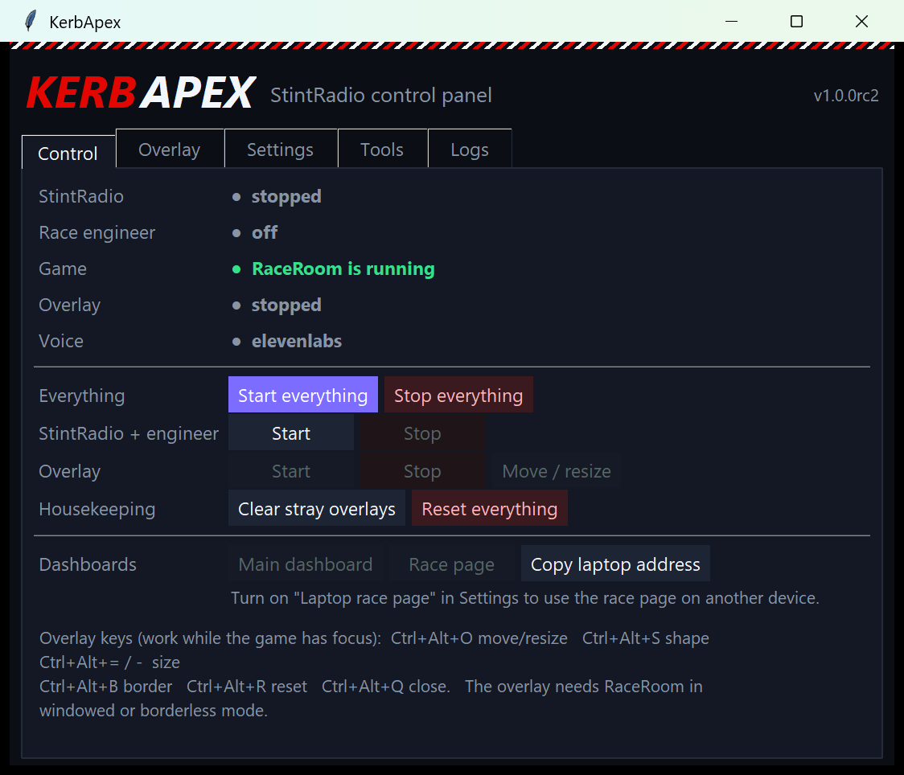

# KerbApex

**A race engineer on your team radio, and a see-through overlay over your sim.** For **RaceRoom Racing Experience**
(fully supported) and **Le Mans Ultimate** (coaching works; some newer features come to it later). Windows.

KerbApex reads your sim's live data, read-only, and talks to you on the straights like a real engineer: how the lap went, the
corner that cost you the most and why, when to brake, which gear, who is behind you and where you are losing time to the car ahead.
It speaks in your own cloned voice (ElevenLabs) or an offline Windows voice. Nothing is ever written to the game.



## What you get

| | |
|---|---|
| **Race engineer** | Lap debriefs, the corner losing the most time and the habit behind it, braking countdowns, "nailed it" calls, race gaps and the drivers around you by name, pit strategy answers, driving tips, setup experiments (brake bias and more, with a before/after verdict). Quiet after your first laps, speaking up when something is worth saying. |
| **Briefing and pits** | A short briefing before each session, built from your earlier runs here (the lap to beat and the corners to work on), said as advice for laps you have yet to drive. It knows when you are in the pit lane and when a new race starts. |
| **See-through overlay** | A real transparent window over RaceRoom (windowed or borderless): live track map with the cars around you, your delta, sector up/down chips, the **next turn** (number, distance, what it is like, gear) and the **three corners to work on**. Any shape, any size, any corner, saved. |
| **Dashboards** | A full dashboard for a second screen, and a read-only race page for a laptop or phone on your network. They keep the last data on screen when the race ends. |
| **Studio** | Turn a RaceRoom replay into a finished video: the replay is played in the game, cameras are cut automatically (cockpit main picture, other views in a box), recorded through OBS and given a title card and fades. Optional private YouTube draft. From the **Studio** tab; runs from the source download (needs OBS and ffmpeg). |
| **Control panel** | One window to start and stop everything, change settings, shape the overlay, read logs, run the checks. |



## Any sim

The sim and the tool meet at a small, versioned **data contract**. RaceRoom and Le Mans Ultimate are adapters; adding another sim is one
Python file dropped in a folder (no changes to KerbApex), and the features that sim can feed switch on by themselves. See
[Sim adapters](StintRadio/docs/ADAPTERS.md).

## Install

**Download** `KerbApex-Setup-<version>.exe` from the Releases page, run it, and open **KerbApex** from the Start menu.
Press **Start everything**. The engineer waits for the game and starts talking when you are on track.

Needs: Windows 10 or 11, RaceRoom (shared memory is always on) or Le Mans Ultimate (turn **Enable Plugins** on in its settings
and restart it once), headphones or speakers, and [ffmpeg](https://ffmpeg.org) on the PATH (`winget install Gyan.FFmpeg`) for the
voice clips and push-to-talk. **Voice is optional:** with an [ElevenLabs](https://elevenlabs.io) key in the `ELEVENLABS_API_KEY`
environment variable the engineer speaks in your own voice; without one it stays quiet or uses the offline voice.
Spoken free-form questions use the [Claude CLI](https://claude.com/claude-code) if you have it; everything else works without it.

Not sure everything is in place? **Tools > Check my setup** says what is missing and how to fix it.

**From source** (Python 3.11+):

```
cd DriverDirector && python -m venv .venv && .venv\Scripts\python -m pip install -e .[dev]
cd ..\StintRadio && python -m venv .venv && .venv\Scripts\python -m pip install -e ..\DriverDirector -e .[dev]
.venv\Scripts\python -m stintradio gui          # the control panel
```

## Documentation

[User guide](StintRadio/docs/USER_GUIDE.md) · [Settings](StintRadio/docs/SETTINGS.md) · [Troubleshooting](StintRadio/docs/TROUBLESHOOTING.md) ·
[Privacy](StintRadio/docs/PRIVACY.md) · [Sim adapters](StintRadio/docs/ADAPTERS.md) · [Technical reference](StintRadio/docs/REFERENCE.md) · [Building](StintRadio/docs/BUILDING.md) ·
[Changelog](StintRadio/CHANGELOG.md)

## Privacy

Everything runs on your PC. There is no account and no telemetry. The only things that leave it are what you switch on: the text of
the engineer's sentences to ElevenLabs (with your own key) and, for spoken questions, your question and some session facts to the
Claude CLI you are signed in to. See the [privacy page](StintRadio/docs/PRIVACY.md).

## Also in this repository

- **[DriverDirector](DriverDirector/)** (the engine behind **Studio**): an automated replay director. It picks a replay and a driver, plans the camera work,
  records through OBS and produces the finished video with commentary and music. StintRadio uses it as a library.
- **Claude Code plugins** (`claude plugin marketplace add atfrank/kerbapex`): `stintradio` (control the engineer from a chat),
  `driverdirector`, and `kerbapex-dev` (a debugger and sandboxed self-improvement rounds: `python dev-plugin/scripts/kdev.py doctor`).

## Not affiliated

KerbApex is an independent project. It is not affiliated with or endorsed by Sector3 Studios, Studio 397, Motorsport Games,
ElevenLabs, Anthropic or Coach Dave Academy. RaceRoom Racing Experience, Le Mans Ultimate, ElevenLabs, Claude and Coach Dave Delta are
trademarks of their owners. API keys are read only from environment variables; none are stored in this repository.

## Licence

MIT, see [LICENSE](LICENSE).
